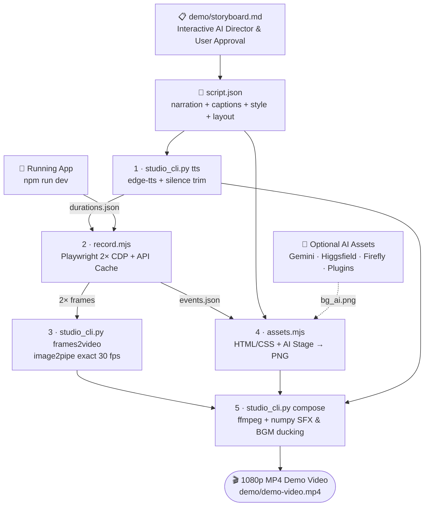
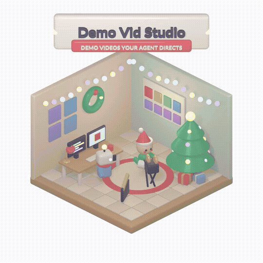
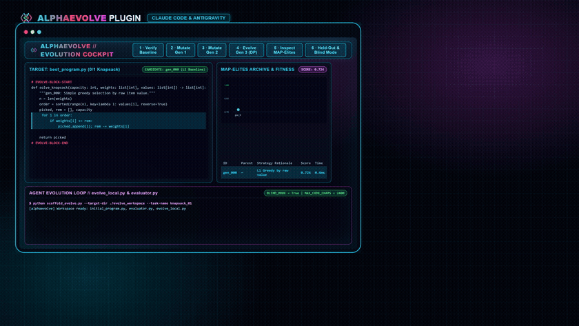

# 🎬 Demo Vid Studio (`demo-vid-studio`)

An AI-directed, code-driven **1080p narrated demo video production skill** for **[Antigravity](https://antigravity.google)**, **[Claude Code](https://claude.com/claude-code)**, and **Gemini CLI**.

Inspired by the narrated prototype walkthrough pipeline from [`sentiment_translator`](https://github.com/bakeyeon/sentiment_translator/blob/main/docs/demo-video.md), `demo-vid-studio` turns any web or mobile prototype into a polished 1080p walkthrough video — complete with neural narration, 2× Retina screen capture, live UI zooms, glassmorphic/stylized feature cards, synthesized sound effects, and auto-ducked background music — without opening a video editor.

---

## ✨ Key Features

1. **Interactive AI Director (`storyboard.md` First)**
   - Before recording a single frame, the agent scans your project, recommends key features to highlight, asks whether you have a script or want it to write one, and presents a scene-by-scene markdown storyboard (`demo/storyboard.md`) for your approval.
2. **One Event Log (`events.json`) Synchronization**
   - Narration is generated first (`durations.json`). The Playwright recorder waits for each voice line to finish before performing the next tap or scroll, logging every timestamp to `events.json`. Cards, captions, live cropped zooms, and sound effects are all placed from that single log.
3. **6 Signature Visual & Audio Style Presets (`--style`)**
   Each style themes both the **1080p HTML/CSS stage, cards, typography & device frame** and the **procedurally synthesized background music & sound effects**:
   - `ambient` *(Default)* — Pastel aurora mesh gradient, frosted glassmorphism cards (`Sora`/`Inter`), soft ambient pads & bell arpeggio BGM.
   - `minimal` — Apple/Linear-inspired sleek dark slate monochrome, 1px borders, subtle minimal pulse BGM.
   - `cartoon` — Neo-brutalist pop-art, bold 4px black borders & hard offset shadows, comic speech-bubble captions, upbeat 8-bit chiptune BGM.
   - `storybook` — Warm parchment paper texture & watercolor washes, serif typography (`Fraunces`), music-box & harp waltz BGM.
   - `clay3d` — Soft 3D claymorphism with puffy inner/outer shadows & toy-like bezel, marimba/wood-bell procedural BGM.
   - `cyberpunk` — Deep dark cyber grid, neon cyan/magenta glowing HUD cards, synthwave bass arpeggio BGM.
4. **2 Layout Presets (`--layout`)**
   - `mobile` — Simulated smartphone (`390×844` touch at 2× DPR) on the left + large `940×610` feature & zoom card on the right.
   - `desktop` — Simulated widescreen browser (`1280×800` at 2× DPR) on the left + companion card on the right + bottom caption bar.
5. **Pluggable AI Image & Video Asset Generation (`generate-asset`)**
   - Works 100% free & offline with pure HTML/CSS/SVG rendering by default.
   - Optionally integrates with installed agent plugins (`image-generator`, `gemini-api-cli`, `gemini-omni-flash-api`, Canva/InVideo) or API keys in `~/.env` / `.env` (**Google Gemini / Imagen 3**, **Higgsfield AI**, **Adobe Firefly**, **Fal.ai / Flux**, **OpenAI**) to generate custom 3D clay dioramas, storybook illustrations, or studio backgrounds.
   - Higgsfield, Adobe Firefly and Fal are **experimental**: their endpoints and auth may need adjusting for your account.
6. **Social Formats (`--vertical`, `--square`, `--square-gif`)**
   - The agent asks whether you also want a **1080×1920 vertical MP4** (Reels, Shorts, TikTok), a **1080×1080 square MP4**, and/or a **square GIF** for feeds.
   - Both are re-framed from the 1080p master: the device and the feature card are stacked (or set side by side when that reads better), the caption sits underneath, and a blurred copy of the video fills the background. No re-recording needed.
   - Already have a video? `studio_cli.py reframe --target demo --formats vertical,square,square-gif --output demo/reframe.json`
7. **Blender 3D Stage & Titles (free, no API key)**
   - If [Blender](https://www.blender.org) is installed, `generate-asset --provider blender` renders a style-matched 3D set: a stage background (`--kind background`) or a 3D title intro/outro clip (`--kind intro|outro --title ... --subtitle ...`), at any size (`--width/--height`, e.g. 1080×1080 for a square cut).
   - `compose --intro-clip/--outro-clip` puts the clips around the 16:9 master; `wrap` does the same for any cut (vertical or square), fitted to its size.
   - Blender is found on `PATH`, in the usual install folders, or via `BLENDER_PATH`. Tested with Blender 5.3 (EEVEE).

---

## 🏗️ The 5-Stage Pipeline



---

## 🚀 Installation

### Windows (PowerShell)
```powershell
.\install.ps1
```

### macOS / Linux
```bash
chmod +x install.sh
./install.sh
```

This installs `demo-vid-studio` globally into:
- **Antigravity**: `~/.gemini/config/skills/demo-vid-studio`
- **Claude Code**: `~/.claude/skills/demo-vid-studio`
- **Gemini CLI**: `~/.gemini/skills/demo-vid-studio`

### Prerequisites
- **Node.js** + **Playwright** (`npm i -D playwright && npx playwright install chromium`)
- **FFmpeg** (`ffmpeg` on PATH)
- **Python 3.9+** with `edge-tts`, `numpy`, `scipy`. With [`uv`](https://docs.astral.sh/uv/), `uv run studio_cli.py ...` installs them automatically from the script's inline metadata. Without uv:
  ```bash
  pip install edge-tts numpy scipy
  ```

---

## 💡 Usage

Open any project in **Antigravity** or **Claude Code** and say:

> *"이 프로젝트 데모 영상 찍어줘!"*  
> *"Record a 1080p demo video for this app in clay3d style."*

The agent will:
1. Scan your project and suggest key features to highlight.
2. Ask if you have a script or want it to draft one, and let you pick a `--style` (`ambient`, `minimal`, `cartoon`, `storybook`, `clay3d`, `cyberpunk`) and `--layout` (`mobile`, `desktop`).
3. Ask which extra formats you want: README `preview.gif`, silent MP4, vertical 9:16 MP4, square GIF.
4. Present `demo/storyboard.md` for your confirmation.
5. Run the 5-stage pipeline and output `demo/demo-video.mp4` (plus `demo-video-vertical.mp4` / `demo-video-square.gif` if requested).

---

## 📂 Examples

### Square clay3d demo of this skill (`examples/self_demo/`)

[`examples/self_demo/`](./examples/self_demo/) is a 48-second **1080×1080** demo of Demo Vid Studio made with Demo Vid Studio: `clay3d` style, a Blender-rendered stage and square backdrop, and Blender 3D title intro/outro.



### Cyberpunk desktop demo (`examples/alphaevolve_demo/`)

See [`examples/alphaevolve_demo/`](./examples/alphaevolve_demo/) for a complete end-to-end showcase demonstrating how `demo-vid-studio` directed and produced a **50-second Cyberpunk 1080p demo video** for [`bakeyeon/alphaevolve-plugin`](https://github.com/bakeyeon/alphaevolve-plugin):



- [`examples/alphaevolve_demo/README.md`](./examples/alphaevolve_demo/README.md) — Showcase overview with silent preview GIF, silent 1080p MP4, and full narrated 1080p MP4
- [`examples/alphaevolve_demo/storyboard.md`](./examples/alphaevolve_demo/storyboard.md) — The AI-directed scene-by-scene storyboard approved before shooting
- [`examples/alphaevolve_demo/script.json`](./examples/alphaevolve_demo/script.json) — Narration lines (`say`), captions (`cap`), `cyberpunk` style, and `desktop` layout config
- [`examples/alphaevolve_demo/cockpit.html`](./examples/alphaevolve_demo/cockpit.html) — Self-contained `1280×800` Live Evolution Cockpit web UI (an illustrative mock: the scores in it are scripted, not from a real run)
- [`examples/alphaevolve_demo/record.mjs`](./examples/alphaevolve_demo/record.mjs) — 2× CDP Playwright screencast recorder with neon click ripples and `events.json` logging
- [`examples/alphaevolve_demo/assets.mjs`](./examples/alphaevolve_demo/assets.mjs) — 6 Cyberpunk HUD cards (including live 2× cropped MAP-Elites region zoom) and timeline builder
