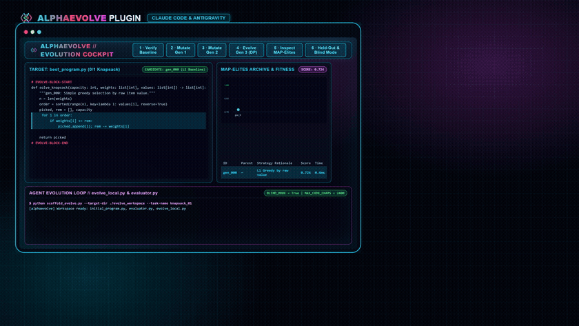

# 🎬 AlphaEvolve Plugin — Cyberpunk 1080p Demo Showcase

This directory contains a complete end-to-end example of a **50-second, 1080p narrated demo video** directed and produced by **`demo-vid-studio`** for **[`bakeyeon/alphaevolve-plugin`](https://github.com/bakeyeon/alphaevolve-plugin)** (an evolutionary algorithm discovery plugin for Claude Code and Antigravity).



---

## 📼 Video Outputs in This Folder

| File | Description |
| :--- | :--- |
| **[`preview.gif`](./preview.gif)** | Silent auto-playing animated walkthrough embedded above |
| **[`alphaevolve-cyberpunk-demo-silent.mp4`](./alphaevolve-cyberpunk-demo-silent.mp4)** | Full 1080p 30fps silent video (`-an`) for lightweight embeds |
| **[`alphaevolve-cyberpunk-demo.mp4`](./alphaevolve-cyberpunk-demo.mp4)** | Full 1080p 30fps narrated video with `en-US-AvaNeural` voice, synthwave BGM, synthesized SFX (`click`, `whoosh`, `ding`), and automatic voice ducking |
| **[`preview.png`](./preview.png)** | 1080p still frame from Scene 4 showing the **live 2× cropped MAP-Elites region zoom** inside the right HUD card |

---

## 🛠️ How It Was Made with `demo-vid-studio`

1. **AI Directing & Storyboard Approval ([`storyboard.md`](./storyboard.md))**
   - The agent scanned `alphaevolve-plugin`, proposed a 6-scene highlight arc (`gen_000` Greedy baseline `0.724` → `gen_003` Optimal 1D DP `1.000`, live MAP-Elites 2× zoom, and `--held-out` / `BLIND_MODE = True` guardrails), and generated [`storyboard.md`](./storyboard.md) using the `cyberpunk` style and `desktop` layout preset.
2. **Stage 1 — Narration ([`script.json`](./script.json))**
   ```bash
   python ../../skills/demo-vid-studio/scripts/studio_cli.py tts --target . --output tts_result.json
   ```
3. **Stage 2 — 2× CDP Recording ([`record.mjs`](./record.mjs) + [`cockpit.html`](./cockpit.html))**
   ```bash
   node record.mjs
   ```
4. **Stage 3 — Exact 30fps Frame Piping**
   ```bash
   python ../../skills/demo-vid-studio/scripts/studio_cli.py frames2video --target . --output f2v_result.json
   ```
5. **Stage 4 — Cyberpunk HUD Cards & Neon Captions ([`assets.mjs`](./assets.mjs))**
   ```bash
   node assets.mjs
   ```
6. **Stage 5 — Synthwave Audio Synthesis & 1080p FFmpeg Composition**
   ```bash
   python ../../skills/demo-vid-studio/scripts/studio_cli.py compose --target . --style cyberpunk --video-out alphaevolve-cyberpunk-demo.mp4 --output compose_result.json
   ```
