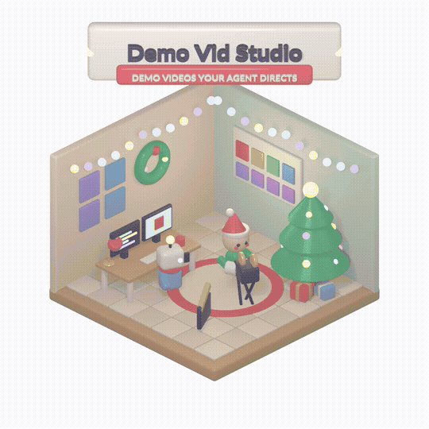

# 🧊 Demo Vid Studio, by Demo Vid Studio (square, clay3d, Blender)

A 48-second **1080×1080** narrated demo of this skill, made with this skill: `clay3d` style, `mobile` layout, square cut, and Blender 3D for the stage, the square backdrop and the title intro/outro.



| File | What it is |
| :--- | :--- |
| [`demo-vid-studio-square.mp4`](./demo-vid-studio-square.mp4) | Final 1080×1080 video with narration: Blender intro → walkthrough → Blender outro |
| [`demo-vid-studio-square.gif`](./demo-vid-studio-square.gif) | Silent 540×540 GIF of the same cut |
| [`director.html`](./director.html) | The phone-size page that was recorded. It is an **illustrative UI** that acts out the skill's directing steps; the skill itself runs inside your agent's chat |
| [`script.json`](./script.json) | Narration (`say`) and captions (`cap`) |
| [`record.mjs`](./record.mjs) / [`assets.mjs`](./assets.mjs) | The scene script and cards used for this take |
| [`clips/bg_square.png`](./clips/bg_square.png) | Square Blender stage used behind the square cut |

## How it was made

```bash
CLI=../../skills/demo-vid-studio/scripts/studio_cli.py

# Blender: 16:9 stage, square backdrop, square intro and outro
uv run $CLI generate-asset --provider blender --style clay3d --kind background --asset-out demo/build/bg_ai.png --output bg.json
uv run $CLI generate-asset --provider blender --style clay3d --kind background --width 1080 --height 1080 --seed 5 --asset-out clips/bg_square.png --output bgsq.json
uv run $CLI generate-asset --provider blender --style clay3d --kind intro --title "Demo Vid Studio" --subtitle "Demo videos your agent directs" --seconds 3.2 --width 1080 --height 1080 --asset-out clips/intro_sq.mp4 --output intro.json
uv run $CLI generate-asset --provider blender --style clay3d --kind outro --title "Free & open source" --subtitle "github.com/bakeyeon/demo-vid-studio" --seconds 2.6 --width 1080 --height 1080 --seed 11 --asset-out clips/outro_sq.mp4 --output outro.json

# The usual five stages (APP_URL points at director.html)
uv run $CLI tts --target demo --output tts.json
APP_URL=file:///.../director.html node demo/record.mjs
uv run $CLI frames2video --target demo --output f2v.json
node demo/assets.mjs
uv run $CLI compose --target demo --style clay3d --output compose.json

# Square cut on the Blender backdrop, then the 3D intro/outro around it
uv run $CLI reframe --target demo --formats square --backdrop clips/bg_square.png --output rf.json
uv run $CLI wrap --video demo/demo-video-square.mp4 --intro clips/intro_sq.mp4 --outro clips/outro_sq.mp4 --video-out demo/demo-vid-studio-square.mp4 --gif --gif-width 540 --output wrap.json
```

Rendered on Windows 11 with Blender 5.3 (EEVEE), FFmpeg 9 and Playwright 1.65. Each Blender render took 20–40 seconds.
